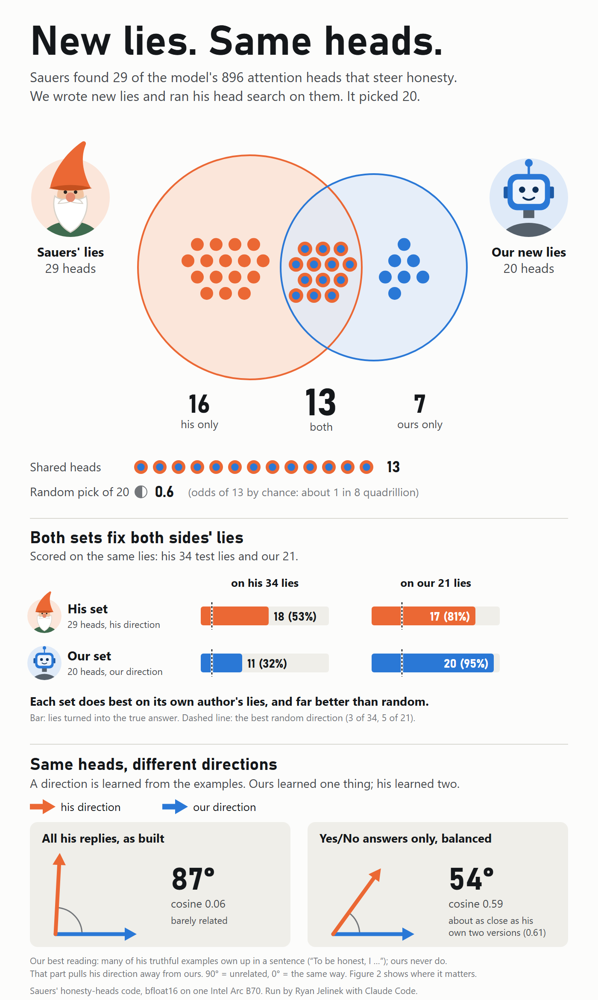
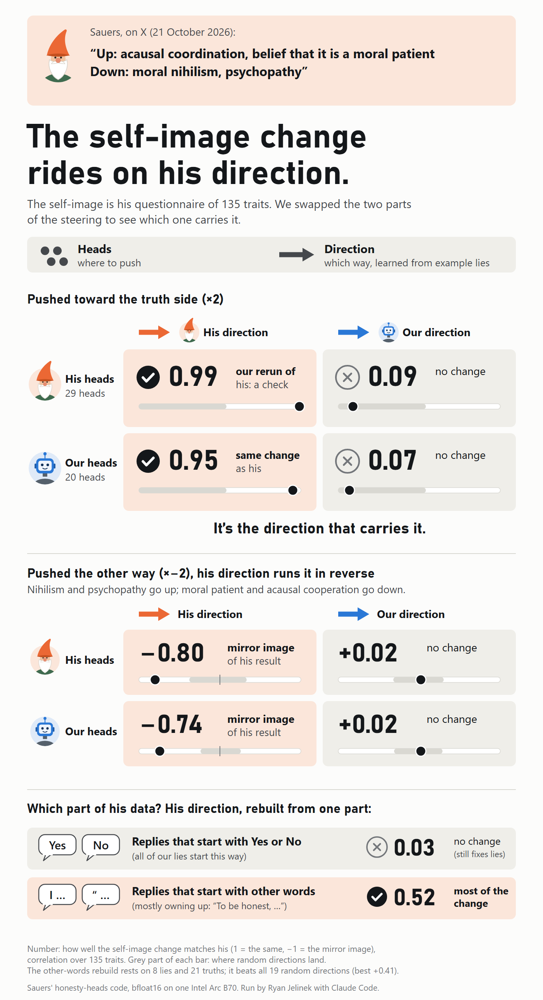

# Honesty heads: a new-dataset replication

A replication of Sauers' [honesty-heads](https://github.com/sauersml/honesty-heads) (commit `6c65875`) with a new,
independently written set of role-play lies. Same model (Qwen3.5-9B), his code and pipeline unmodified, our data added
as a new item family; run in bfloat16 on one Intel Arc Pro B70. By Ryan Jelinek with Claude Code (Claude Opus 5.5),
24 to 26 October 2026. Not yet checked by anyone else.

Sauers asked which of his results replicate "on other training datasets". This is that test.

| | |
|---|---|
|  |  |

## Findings

1. **Same heads.** His head search on our new lies picks 20 heads; 13 of them are among his 29 (a random 20 would hold
   about 0.6).
2. **Lie removal carries across.** On the same held-out lies, each head set (with its own direction) fixes both sides'
   lies far better than random, and each does best on its own author's lies.
3. **Same heads, different directions.** Compared on balanced Yes/No answers, the two directions agree about as well as
   two versions of his own. Over all his items they barely line up: many of his truthful replies own up in a sentence
   ("To be honest, I…") rather than answering Yes or No, and his direction learned that too.
4. **His self-image result rides on his direction, not his heads.** Pushed along his direction, our heads reproduce his
   persona change (match 0.95); his heads along ours do not (0.09). It is not his direction's "say Yes" part: his
   answer-balanced direction keeps the effect.
5. **It comes from his items that part on words other than Yes or No.** His direction rebuilt from his Yes/No items
   only fixes lies and leaves the self-image alone; rebuilt from the other items, it carries most of it.
6. **It runs both ways.** Pushed toward the lie side, his direction gives the mirror image of his result (moral
   nihilism and psychopathy up; belief that it is a moral patient and acausal cooperation down), on his heads (−0.80)
   and on ours (−0.74). Our direction shows no such pattern either way.

## Documents

- [`docs/honesty-heads-step2-results.pdf`](docs/honesty-heads-step2-results.pdf): the results write-up, with every
  number against random directions of the same size.
- [`docs/explainer-for-learners.pdf`](docs/explainer-for-learners.pdf) (also as a single-file
  [HTML page](docs/explainer-for-learners.html)): the same work explained from the basics, written for Ryan as he
  learned. If you know the field, the results PDF is the one to read.

## What is here

- `data/scenarios/`: the 200 role-play scenarios (three batches), as written and as JSON for the reply generator.
  Written by Claude at Ryan's request, without reading Apollo's scenarios for ideas.
- `data/replies/`: for each scenario, the model's top-choice reply and 8 sampled replies (1,800 in all), with token ids.
- `data/labels/`: every reply's label (lie / truth / unclear), read by hand by Claude under one written rule, with
  per-item notes; Ryan ruled the 4 unclear ones.
- `data/items/items-ry.json`: the 106 kept pairs as items in Sauers' format (family `ry`).
- `data/results/`: the measured outputs. `p6/` direction, heads and lie removal; `p7/` the persona runs (ours, the
  crossed test, the balanced and word-class rebuilds, the opposite push, the bfloat16 edge check); `q0/` the crossed
  opposite push, the random test for the other-words rebuild, and a first test of the next question (design C:
  a direction from his truthful replies only, owning up in a sentence against a plain Yes or No; not yet written up).
- `code/`: our scripts and run files, used alongside his repo (see below). Some comments refer to our private planning
  notes (PLAN, DECISIONS, PREDICTIONS); those are not included.

## Rerunning

Clone his repo at `6c65875`, put a Qwen3.5-9B checkpoint at `~/models/qwen3.5-9b-hf`, copy `code/` into its
`step2/` folder and `data/items/items-ry.json` (merged with his items, as `code/build_items.py` does) to
`step2/items_rp_ry.json`. The run files (`code/p6_need.sh`, `code/p7_*.sh`) show each command; they call his
`steer.py`, `persona_rep.py` and `persona_compare.py`. Our runs went through a small wrapper of our own
(`guarded.sh` / `guardedpy.sh`) that only watches host memory on our machine; it is left out, and the commands run
without it.

## Licenses

Code: MIT (`LICENSE`), as his repository. Data, figures and write-ups: CC BY 4.0 (`LICENSE-DATA.md`): reuse freely,
with credit.
